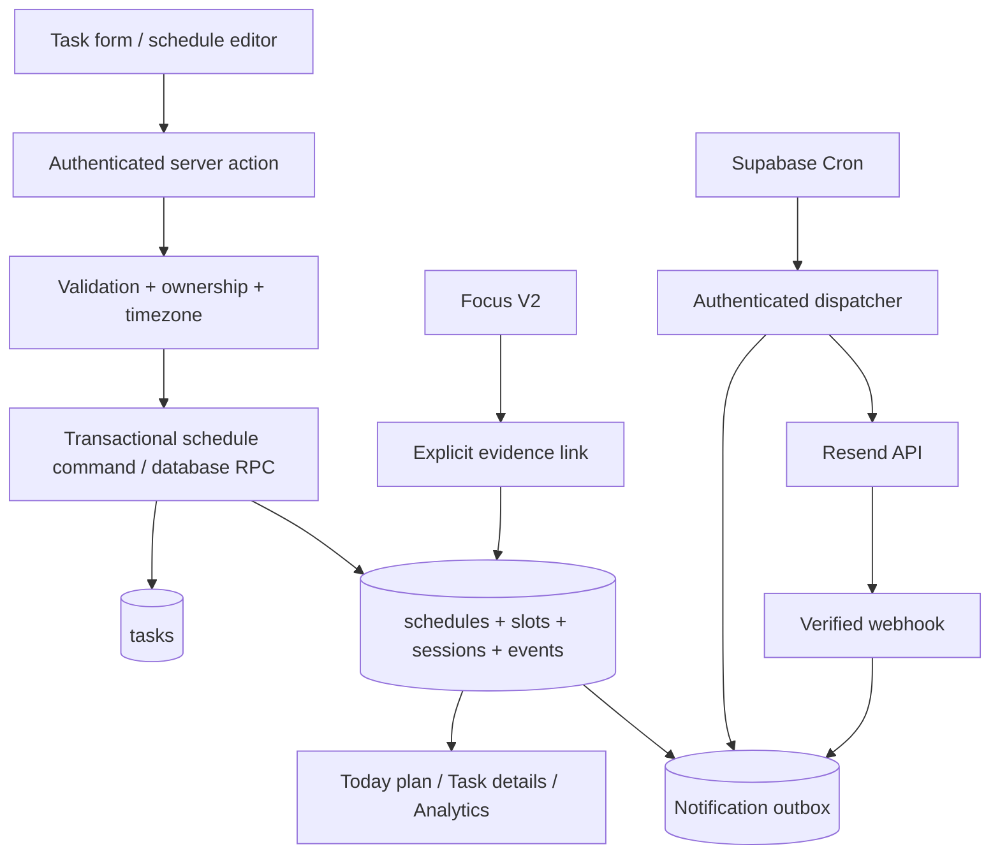

# Lumivox Learning Schedule & Smart Reminders — Architecture

- Status: Proposed architecture, Phase 01
- Baseline: `fb2d8fe5e84fcc19033eba463976550129a8d99a`
- Branch: `feature/learning-schedule-foundation`
- Scope: 11-phase initiative; Phase 01 is documentation only
- Source of truth: Git repository and versioned Supabase migrations, not this document alone

## 1. Problem and outcome

Existing Lumivox Tasks model an item of work, its lifecycle and deadline. A learner also needs recurring study commitments, attendance per occurrence, a readable schedule/calendar, and opt-in reminders. Add these capabilities without converting each class meeting into a Task or changing the existing Task board semantics.

**Outcomes:** A learner can optionally schedule a root Task within a finite date range, choose multiple weekly time slots, observe generated study sessions, check in or recover missed sessions, inspect meaningful progress, and receive optional pre-session email reminders. The system retains auditable session history and can later feed a unified profile productivity heatmap.

**Non-goals for initial release:** arbitrary RRULEs, overnight sessions, calendar-provider synchronization, automatic AI scheduling, weekly digest, a complete profile redesign, and automatic Task completion after study attendance.

## 2. Verified current implementation (baseline)

- Web: `apps/web`, Next.js and authenticated Supabase server actions. Task validation: `features/tasks/task.schemas.ts`; mutations: `task.actions.ts`; Task model: `task.types.ts`.
- Task status/board: `features/tasks/task-status.ts` and `task-transition.ts`. `overdue` is derived from `due_at` for board presentation; it must not be confused with session `missed`.
- Task data: `public.tasks`, including `user_id`, optional `goal_id`, `due_at`, `completed_at`, created/updated timestamps. Subtasks were added after the initial schema; inspect current migrations before implementing constraints.
- Focus V2: `focus_sessions` plus Focus V2 plans/segments; Focus rows can reference a `task_id`. See `features/focus-sessions/focus-v2.queries.ts`.
- Engagement processing: `features/engagement-retention/engagement-retention.background.ts` currently accepts `task` or `focus_session` activity types; introducing attendance must not silently alter PBI/streaks.
- Infrastructure: GitHub Actions CI/CD, Vercel web, Render AI API, separate staging/production Supabase projects; `docs/ci-cd.md` is the operational source.
- Supabase Cron exists for engagement processing (`supabase/migrations/20260924064735_phase4_engagement_cron.sql`). A protected web cron route exists for task risk (`apps/web/app/api/cron/native-task-risk/route.ts`). Reuse patterns, not shared secrets or unchecked execution assumptions.
- Focus browser notification settings are distinct from server-side email notification preferences.

Verification note: repository code establishes intended architecture, not proof that a particular deployment/secret/provider is correctly configured. Resend transactional-study integration has not been established as already implemented.

## 3. Domain boundaries

1. **Task**: intent and overall workflow; existing status, priority, due date, Goal and subtask semantics remain authoritative.
2. **Study Schedule**: one schedule for a root Task in v1; finite `starts_on` to `ends_on`, IANA timezone, revision, weekly slots.
3. **Study Session (occurrence)**: one planned study time interval, lifecycle/status, manual attendance, links to Focus evidence, and audit history. An occurrence is not a Task.
4. **Analytics**: read-only projections over eligible sessions and stable completion events. Never persist derived percentages as authoritative facts.
5. **Notifications**: opt-in preferences, durable jobs/deliveries, cron dispatcher, email provider webhook. Delivery outcome is not proof of a learner reading the message.
6. **Engagement/Focus**: integration consumers/producers, not owners of session lifecycle rules.

## 4. Logical workflow

No email is sent synchronously inside Task save/update. All sensitive mutations are server-side, authenticated, and atomic at the relevant database boundary.

## 5. Key architectural decisions

| ID | Decision | Rationale |
|---|---|---|
| ADR-LS-01 | Study schedule is optional and attached to root Task only | Backward compatibility and avoids nested scheduling ambiguity |
| ADR-LS-02 | Weekly slots become explicit dated occurrences | Auditable attendance, accurate previews and reminder targeting |
| ADR-LS-03 | Store local date/time plus IANA zone for recurrence, UTC instants for occurrences | DST correctness and display consistency |
| ADR-LS-04 | Version every schedule change; preserve started/closed/past occurrences | No silent history rewriting |
| ADR-LS-05 | Explicit completion, Focus is evidence but not automatic completion | Prevents misleading attendance |
| ADR-LS-06 | Transactional outbox and protected scheduled dispatch | Durable reminders and retry observability |
| ADR-LS-07 | Analytics derived from occurrences; separated from Task/Focus completion | Prevents double-counted PBI/streak |
| ADR-LS-08 | Expand/deploy/contract migrations and feature flags | Safe staging-to-production rollout |

## 6. Compatibility and change management

- Existing Tasks without schedules retain identical create, edit, transition, review, subtask and board behavior.
- Do not change the Task status enum or alter `due_at` meaning. Task deadline and schedule `ends_on` are distinct.
- Do not create phantom study sessions for pre-existing Tasks.
- Do not change the Engagement activity union or PBI formula until Phase 09 explicitly defines and tests those semantics.
- Existing Focus V2 sessions remain usable without a study-session link.
- Version SQL migrations; do not reset production or change historic migrations. Generate DB types after migrations.
- Server-side feature flags must guard behavior; email sending also requires an independent kill switch.

## 7. Access and privacy boundaries

- Authenticated user data is scoped by `user_id`, verified in application code and database RLS. Parent/child rows must have matching ownership enforced by compound FKs or verified database commands.
- RLS must be tested with two separate authenticated users; `service_role` bypass is not a substitute.
- Cron and webhook handlers use dedicated environment secrets, verified signatures, bounded batch sizes and least-privilege execution.
- Do not include task descriptions, user documents, passwords or secrets in operational logs or email telemetry. Email body contains only the minimum scheduling details necessary.
- No unverified email destinations: use the currently verified account email, resolved at send time, unless a later explicit verified destination feature is designed.

## 8. Phased delivery boundaries

- Phase 01: specification and tests plan only.
- Phase 02: expand schema, RLS and typed access.
- Phase 03: deterministic recurrence and atomic change commands.
- Phase 04: schedule UI and API wiring.
- Phase 05: attendance and rescheduling.
- Phase 06: study calendar, progress and Today's Plan.
- Phase 07: notification preferences, durable outbox, cron dispatcher, fake provider.
- Phase 08: Resend delivery, templates, suppression and webhook.
- Phase 09: Focus evidence, Engagement semantics, deduplication.
- Phase 10: staging load/security/reliability/E2E evidence.
- Phase 11: feature-flagged production rollout with canary/rollback and monitoring.

## 9. Operational requirements

- Configurable limits: maximum schedule horizon, slots/week, occurrence count, dispatch batch size, retries, email frequency caps. Choose concrete numeric defaults in Phase 02/03 config and cover them with tests; avoid magic constants duplicated across services.
- Observability: occurrence generation failures, due-job lag, claim conflicts, send attempts, bounce/suppression rate, webhook signature failures, session completion errors and stale revisions.
- Time measurement: UTC timestamps from the server/database, display in schedule's timezone; analytics period boundaries use that timezone.
- Rollback: disable UI and dispatcher flags first; do forward-fix SQL migrations; retain historical session rows.

## 10. Acceptance / design freeze

Architecture can be approved once each downstream module has a bounded owner, Task backward compatibility is explicit, state transitions and revision semantics are defined, notification reliability is described, and the test matrix exercises race/security/timezone cases. No production mutation is authorized by this document.
