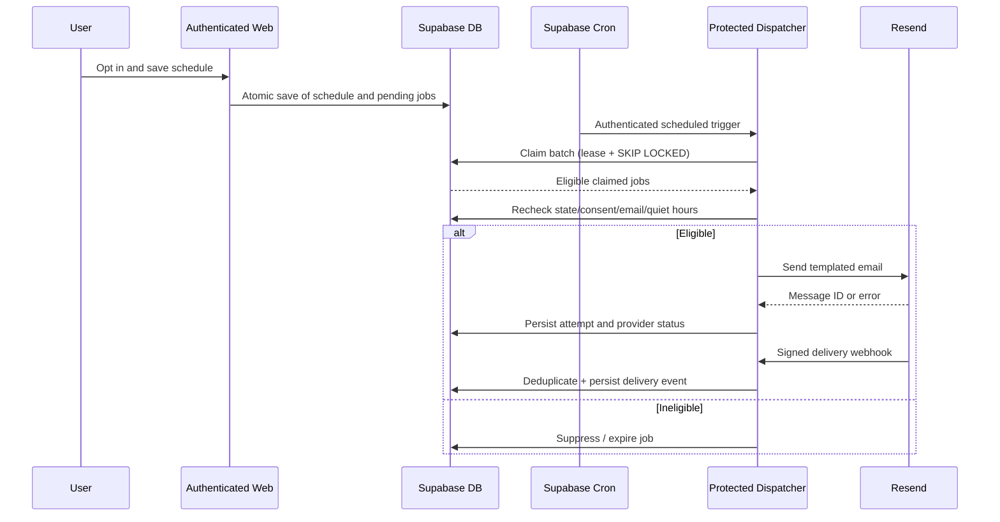

# Study Email Reminders — Notification Architecture

Status: Phase 01 proposed design. Actual provider, secrets and scheduled production configuration are **not** asserted to be live.

## 1. Goal and non-goal

Send relevant, opt-in email reminders shortly before a valid scheduled session with durable tracking, suppression and retry. No claim of exactly-once email delivery or guaranteed inbox placement. GitHub Actions handles CI/CD, not user reminder dispatch.

## 2. Responsibilities

- **Settings UI / authenticated action**: user consent, lead time, quiet hours, optional per-Task override and safe unsubscribe.
- **Scheduling command**: makes durable notification job per eligible occurrence and schedule revision, updates/cancels it on schedule changes, Task closures and attendance completion.
- **Supabase Cron**: regular trigger (target one minute where plan/limits permit); not a precise real-time timer.
- **Dispatcher**: securely claims limited jobs, rechecks eligibility just before provider call, handles transient/permanent failures.
- **Resend**: email submission and asynchronous delivery-status events.
- **Webhook**: validates provider signature, deduplicates events and applies monotonic delivery-state updates; reacts to bounce and complaint.
- **Reconciler**: restores expired leases, expires stale jobs, flags unresolved provider submissions.

## 3. Data flow

## 4. Consent and eligibility

Eligible only if ALL conditions hold at send time:

1. Email feature flag + dispatcher kill switch permit sending.
2. Staging/production environment isolation and destination allowlist rules pass.
3. Auth account email is verified, in good standing, not hard-bounced/complained/unsubscribed.
4. User explicitly opted in; optional Task-level override does not disable.
5. Schedule active, Task not `completed`/`cancelled`, occurrence live and `scheduled` (not completed/skipped/missed/cancelled).
6. Job schedule revision matches effective occurrence and lead-time preference.
7. Send time is not within quiet hours in notification timezone; suppress rather than send later in v1.
8. No duplicate logical reminder accepted for the same occurrence/type/revision.
9. Relevant dispatch window not expired; no reminder after session starts.

If user disables notifications, cancel pending jobs and reject leased jobs during final eligibility check. A request already submitted to provider cannot be recalled; report the edge clearly.

## 5. Job lifecycle

`pending -> leased -> sent` (provider accepted), `pending/leased -> suppressed`, `pending/leased -> expired`, `leased -> pending` (retry), `leased -> failed` (permanent or attempts exhausted). Never claim a provider `delivered` status merely because API returned success. Delivery attempt state is separate and updated by webhooks.

- `due_at = occurrence.start_at - lead_minutes`.
- Unique idempotency key: namespace + occurrence stable ID + notification type + schedule revision (and a policy version if necessary).
- Claim via atomic DB function with SKIP LOCKED, `lease_token`, `lease_until`, bounded batch size and monotonically increasing attempt counter.
- Reconciler releases expired leases, but must check if previous provider call was accepted to avoid unsafe blind resend.
- Use provider-supported idempotency where available and persist provider message IDs as soon as accepted. Exactly-once external delivery is not guaranteed across network timeout uncertainty.
- Retry transient errors (rate limits, provider 5xx/network) with capped exponential backoff/jitter and maximum attempts; **never retry after occurrence start**, absent a future approved policy.
- Permanent errors (invalid/unverified recipient, unsubscribe, hard bounce, authentication or configuration errors) suppress or fail without retry. Alert maintainers on configuration failures.

## 6. User settings contract

- Global `study_email_enabled`: default `false`, explicit opt-in.
- `lead_minutes`: one of `5, 15, 30, 60`, UI default `15`.
- Quiet hours: optional, local start/end, IANA zone; support wrap-around midnight. Quiet hours suppress sends rather than delaying to a stale time.
- Optional per-Task override must never bypass global opt-out.
- Unsubscribe token: scoped, signed, expiring/revocable or single-purpose secure token; must not expose raw user ID as authorization. Landing action should be safe against unauthorized toggles and confirm effect.
- Consent timestamp, source and changed-at can be recorded for audit; do not store unnecessary IP/device identifiers.

## 7. Email content

Template localized `en` / `vi` using verified preferred locale. Subject/body contain task title, local date, start/end, timezone, deep link to Task, a settings/unsubscribe link, and brief plain-language text. Both HTML and plain-text versions. Escape all user-provided strings and use trusted URLs only. Never include uploaded learning documents, private notes or proprietary content in reminders.

Example subject: `Lumivox: Your React study session starts in 15 minutes`.

## 8. Webhook and suppression

- Verify raw-body signature and timestamp using current Resend webhook contract; reject invalid signatures, excessive body size and irrelevant event types.
- Persist provider event ID with uniqueness; process at-least-once, out-of-order delivery events without status regression.
- Distinguish `submitted/sent`, `delivered`, `bounced`, `complained`, `failed`, and `suppressed` with their own semantics.
- Hard bounces and complaints update suppression store for the user/email identity. Do not automatically re-enable by toggling preferences if provider suppression persists.
- Protect webhook secret and redact recipient addresses in logs; record correlation IDs, job ID, provider message ID and error code.

## 9. Security and environment separation

- Protected cron HTTP endpoint must require dedicated secret or hardened authenticated edge invocation; reject unauthorized calls. Do not accept arbitrary recipient, job status or HTML from request body.
- Staging: sandbox/test delivery and allowlisted addresses only, secrets and DB isolated from production.
- Production: separate secrets, verified domain/sender; explicit feature flag, rate limits and gradual rollout.
- CI: mock Resend and verify outbox state machine; CI must not send real customer email.
- Resend sending domain should have valid SPF/DKIM/DMARC; authentication improves deliverability but does not ensure inbox placement.

## 10. Telemetry, alarms, release gates

Track: pending count, oldest eligible job age, claim/lease time, sends/minute, transient/permanent failures, retries, accepted submissions, delivered/bounce/complaint rates, webhook lag, suppression reasons and double-claim attempts. Never equate `sent` to `delivered`.

- Phase 07 gate: fake provider integration passes concurrency/idempotency/suppression/lease expiry tests.
- Phase 08 gate: real verified-provider test accounts receive expected locale and unsubscribe behavior; signed webhook and bounced test cases pass.
- Phase 10 gate: staging load, kill switch, failure injection and recovery tests pass.
- Phase 11 gate: progressive live rollout with thresholds for pausing, documented on-call/rollback playbook.

## 11. Open implementation checks (before Phase 07)

Confirm current Resend account/domain, provider features and rate limits, webhook event list, Supabase Cron availability/quotas, web/Edge/Render execution timeout, config secret management and staging allowlist. Select worker placement from operational evidence rather than assuming any one platform is perfect.
