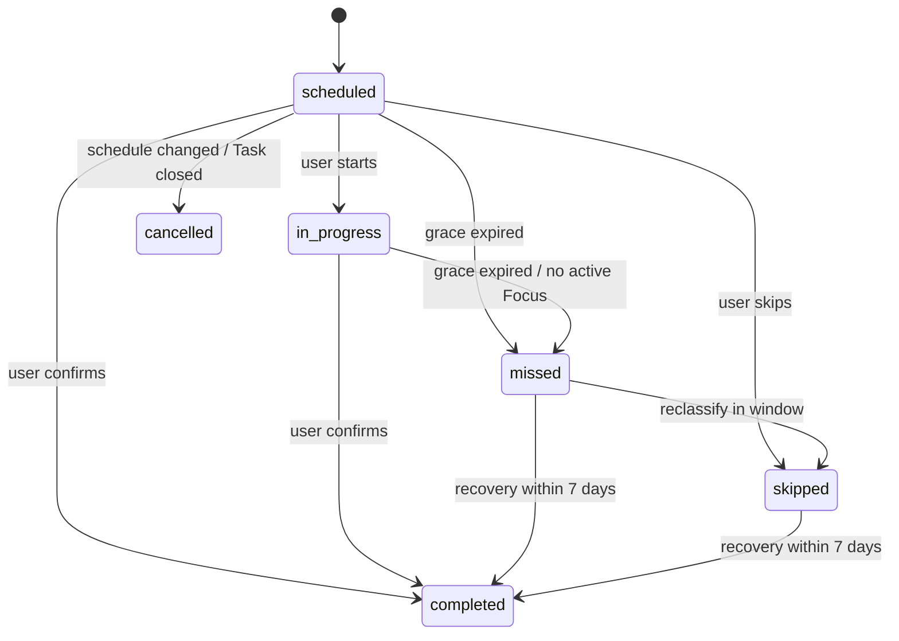

# Study Session — State Machine and Mutation Contracts

Status: Phase 01 proposed contract. This state machine is intentionally separate from `TaskStatus`.

## 1. Canonical states

| State | Meaning | Terminal? |
|---|---|---|
| `scheduled` | planned but not started | No |
| `in_progress` | learner explicitly started the study occurrence | No |
| `completed` | learner explicitly confirmed attendance | Yes (except authorized correction) |
| `missed` | grace cutoff passed with no confirmation | Recoverable for 7 days |
| `skipped` | learner explicitly skipped occurrence | Recoverable for 7 days |
| `cancelled` | obligation withdrawn by schedule/Task/manual change | Yes |

`rescheduled` is recorded as an **event** and/or replacement association. It is not a persisted session state. No automatic transition into `completed` based on Focus minutes.

## 2. Allowed transitions

| From | To | Trigger / guard |
|---|---|---|
| `scheduled` | `in_progress` | Owner starts within allowed window (v1 manual start permitted until grace cutoff) |
| `scheduled` | `completed` | Owner explicit confirmation, in valid attendance window |
| `in_progress` | `completed` | Owner explicit confirmation, valid timing |
| `scheduled` | `missed` | trusted sweep when `now > scheduled_end_at + 60m` |
| `in_progress` | `missed` | trusted sweep after grace, only when no valid active Focus association; if active, defer and reconcile |
| `scheduled` | `skipped` | owner explicitly skips |
| `missed` | `completed` | owner recovers within 7 local calendar days of scheduled date |
| `skipped` | `completed` | owner recovers within 7 local calendar days of scheduled date |
| `scheduled` | `cancelled` | schedule revision / Task closure / owner cancel before start |
| `missed` | `skipped` | owner classification/correction while recovery window open |

No direct transition out of `cancelled`. No ordinary end-user reopening of `completed`. Corrections beyond recovery window require a future privileged audited correction flow. A stale optimistic concurrency token is a conflict, not a silent overwrite.

## 3. Mermaid state diagram

## 4. Time boundaries

- Recurring clock time is in saved timezone; session instants in UTC.
- `grace_deadline = scheduled_end_at + 60 minutes` (absolute elapsed time).
- Late recovery cutoff is the end of the seventh local calendar day **after** the scheduled local date, interpreted in saved timezone. Use an explicit zone-aware function; do not add `7 * 24h` in UTC across DST.
- `scheduled` before start is upcoming; `scheduled` after end but before grace deadline is due/in grace, not yet missed.
- Completing a session after scheduled end is considered late for on-time analytics, even if still within grace.

## 5. Commands and results

### `start(session_id, expected_status, event_key)`
Authenticate user, verify ownership, timing and current state, change `scheduled -> in_progress`, append `started`, return updated row. Retry with same key returns prior result.

### `complete(session_id, expected_status, event_key)`
Authenticate user; ensure transition valid and recovery cutoff (if missed/skipped); atomically set status/completed_at and append exactly one audit event. A duplicate idempotency key returns previously committed result; a genuinely different stale command returns conflict. Suppress unsent jobs for the occurrence.

### `skip(session_id, event_key, reason?)`
Validate owner and source state; set `skipped` and append event. Do not count as completed. Suppress unsent reminders.

### `mark_missed_batch(now, batch_size)`
Privileged bounded batch. Acquire locks; only eligible non-complete sessions past grace. Recheck active Focus condition. Must be safe if two invocations overlap. Append `marked_missed` once per session.

### `revise_schedule(schedule_id, expected_revision, ...)`
Transactional compare-and-swap on revision; preserve terminal/past/in-progress, cancel superseded future scheduled sessions, record change events, insert replacement obligations and jobs. Stale changes fail with a specific conflict.

### `close_task(task_id, status)`
Task status transition remains existing source; in same transaction or a failure-safe reconciled workflow, cancel future scheduled occurrences and unsent notifications. Design implementation so notification can never pass eligibility after Task closes, even if reconciliation is delayed.

## 6. Behavioral invariants

- Session `completed` has nonnull `completed_at` and one authoritative completion; non-completed rows do not pretend to have a completion time.
- A session does not mark its parent Task `completed`.
- A cancelled session does not become missed/completed later.
- A revision cannot alter previous recorded start/end of past sessions, even though future schedule may change.
- `scheduled_start_at < scheduled_end_at` always.
- Exactly one active obligation for a logical occurrence after reschedule/revision.
- Commands are atomic: status, event, notification eligibility and response represent one committed transition.

## 7. Concurrency cases to test

1. Double-click completes one session: exactly one completion event.
2. Simultaneous complete vs cron missed: one final legal state, no lost audit.
3. Reschedule vs reminder claim: no new email for obsolete occurrence after validated cancellation; in-flight provider calls can be impossible to retract and must be logged.
4. Complete vs skip: one commit wins, other returns conflict/idempotent result.
5. Task close vs session complete: consistent end state with precedence defined in transactional command and documented in test.
6. Two schedule editors submit same old revision: only first applies.
7. Active Focus at cutoff: defer miss and reconcile after Focus terminal status, not overwrite active evidence.

## 8. UI representation

Provide distinguishable accessible text/icon/color for `scheduled`, `in_progress`, `completed`, `missed`, `skipped`, `cancelled`; never rely only on color. Surface late completions and historical schedule edits in session detail. Display local time and named timezone when relevant.
